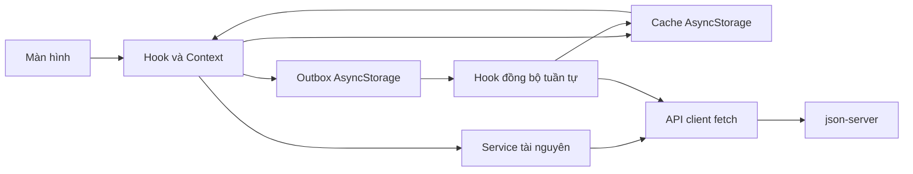

# Thực hành 4 Ứng dụng quản lý học tập

Nâng cấp ứng dụng Thực hành 3 bằng **React Native CLI + TypeScript**: lấy dữ liệu từ REST API, dùng cache khi mất mạng, lưu thao tác offline và tự đồng bộ khi có mạng trở lại. Giao diện dùng thành phần native `View`, `Text`, `FlatList`, `TextInput`, `Pressable`; điều hướng bằng React Navigation. Không dùng Expo.

Cây thư mục và tên thành phần theo sơ đồ của đề; phần mở rộng dùng `.tsx` cho component/màn hình và `.ts` cho logic, theo yêu cầu giữ TypeScript của dự án. Các file cấu hình công cụ như `index.js`, Babel và Metro giữ định dạng của React Native CLI.

## Chạy Android

Cần Node.js >= 22.11, JDK 17, Android SDK theo cấu hình dự án và một thiết bị/AVD có kết nối ADB.

```sh
npm install
npm run api
```

API dùng **json-server 0.17.4** cài cục bộ trong dự án, có độ trễ 800 ms:

```sh
json-server --watch db.json --host 0.0.0.0 --port 3000 --delay 800
```

Trong terminal khác:

```sh
adb reverse tcp:3000 tcp:3000
adb reverse tcp:8081 tcp:8081
npm start -- --reset-cache
```

Trong terminal thứ ba:

```sh
npm run android
```

`src/config.ts` là nơi duy nhất đặt `BASE_URL`, `TIMEOUT = 10000` và `CACHE_TTL`. Cấu hình Android mặc định `http://127.0.0.1:3000` dùng cùng `adb reverse`, chạy được với điện thoại thật hoặc máy ảo. Nếu không dùng reverse:

- Android Emulator: đặt `BASE_URL` thành `http://10.0.2.2:3000`.
- Điện thoại thật: đặt `http://<IP-LAN-máy-tính>:3000`, hai thiết bị cùng Wi-Fi và cho phép cổng 3000 qua tường lửa.
- iOS Simulator: mặc định `http://localhost:3000`. Build iOS trên macOS sau khi chạy `bundle install`, `bundle exec pod install` trong `ios`, rồi `npm run ios`. Chưa kiểm chứng build iOS trên máy Windows.

Sau khi thêm NetInfo cần build lại ứng dụng native; chỉ reload JavaScript là chưa đủ. Nếu nhiều thiết bị kết nối, dùng `adb -s <device-id> reverse ...`.

## Chức năng theo đề

- Tổng quan: hồ sơ sinh viên, môn đang học, bài đến hạn trong 7 ngày tới, bài quá hạn và số thay đổi chưa đồng bộ.
- Môn học: tìm kiếm tên/mã không phân biệt dấu, lọc học kỳ, chi tiết có lịch học và bài tập của môn.
- Thời khóa biểu: chọn Thứ 2 đến Chủ nhật, giờ học, phòng và ghi chú buổi học.
- Bài tập: tìm kiếm, bốn bộ lọc, thêm bài bằng POST, đổi trạng thái bằng PATCH. Form kiểm tra tiêu đề, môn học, ngày giờ hợp lệ và hạn nộp ở tương lai.
- Cá nhân: hồ sơ, form chỉnh sửa họ tên/email/điện thoại, danh sách điểm theo học kỳ, GPA và chi tiết điểm thành phần.
- Mỗi tab có Native Stack riêng; màn chi tiết chỉ nhận `{ id }` và tự gọi endpoint chi tiết. Header cập nhật theo tên mục, có Back; lưu form vào hàng đợi thành công thì quay lại. Badge tab Bài tập là số bài chưa xong.
- Mọi màn dùng `ScreenContainer`, tự hiện “Bạn đang offline”. Các danh sách có tải/rỗng/lỗi/Thử lại và kéo để làm mới.

## Cấu trúc

```text
App.tsx                         # Chỉ bọc Provider và AppNavigator
src/
  config.ts
  api/                          # client và 5 service tài nguyên
    client.ts
    studentService.ts
    courseService.ts
    sessionService.ts
    assignmentService.ts
    gradeService.ts
  storage/                      # AsyncStorage, không gọi API
    keys.ts
    cache.ts
    outbox.ts
  context/
    AppDataContext.tsx           # Dữ liệu chung, thao tác cập nhật
    SyncContext.tsx              # Trạng thái mạng, hàng đợi, thông báo
  hooks/
    useNetworkStatus.ts
    useCachedQuery.ts
    useOutboxSync.ts
    queryStore.ts                # Chia sẻ cache giữa các màn
    syncEngine.ts                # Đồng bộ lần lượt và xử lý xung đột
    useRecord.ts
    useQueryGroup.ts
    useStudyData.ts
  navigation/
    routes.ts
    AppNavigator.tsx             # 5 Bottom Tabs
    HomeStack.tsx
    CourseStack.tsx
    ScheduleStack.tsx
    AssignmentStack.tsx
    ProfileStack.tsx
    options.ts
  screens/
    home/HomeScreen.tsx
    courses/{CourseListScreen,CourseDetailScreen}.tsx
    schedule/{ScheduleScreen,SessionDetailScreen}.tsx
    assignments/{AssignmentListScreen,AssignmentDetailScreen,AssignmentFormScreen}.tsx
    profile/{ProfileScreen,EditProfileScreen,GradeListScreen,GradeDetailScreen}.tsx
  components/
    common/                     # Đủ 11 component chung của đề
    course/CourseCard.tsx
    schedule/{DaySelector,SessionCard}.tsx
    assignment/{AssignmentItem,StatusToggle}.tsx
    grade/{GpaSummary,GradeRow}.tsx
    profile/InfoRow.tsx
  theme/{colors,spacing,typography,layout}.ts
  utils/{date,gpa,validators,pending,errors}.ts
  types/                        # Kiểu tài nguyên, props và điều hướng
__tests__/
db.json
```

Component trình bày nhận props/callback, không đọc Context hay gọi API; `OfflineBanner` là ngoại lệ dùng hook mạng theo đề. Giao diện theo ảnh tham chiếu Slink: đầu trang đỏ, thẻ trắng có bóng nhẹ, môn học dạng lưới hai cột, bộ chọn học kỳ mở rộng và lịch tuần/tháng. Màn hẹp hoặc chữ lớn tự chuyển môn học về một cột. Chỉ dùng hồ sơ, môn, buổi học, bài tập và điểm đã có; không thêm dữ liệu, tin tức, sự kiện hay quảng cáo từ ảnh mẫu. Màu tại `src/theme/colors.ts`, font/cỡ chữ tại `typography.ts`, khoảng cách tại `spacing.ts`. Giao diện sáng, chưa có dark mode.

Trong Thời khóa biểu, kéo thanh ngang xuống để mở lịch tháng, kéo lên để thu về tuần của ngày đang chọn. Lịch di chuyển theo ngón tay và tự về vị trí gần nhất khi thả; cũng có thể bấm thanh ngang hoặc tiêu đề tháng để đổi chế độ.

## Luồng dữ liệu



GET: `Màn hình → useCachedQuery → Cache trước → Service → API → cập nhật Cache và Context`.

Ghi: `Màn hình → Context → lưu Outbox → giao diện cập nhật ngay → useOutboxSync → API → Cache → xóa Outbox`.

`fetch` chỉ nằm trong `api/client.ts`. Client hủy yêu cầu sau 10 giây, kiểm tra HTTP và ném lỗi `{ type, status, message }`, với `type` là `network`, `timeout` hoặc `http`. Service chỉ gọi client, không xử lý cache.

## Cache và đồng bộ offline

- GET thành công lưu `{ data, savedAt }` vào `cache:courses`, `cache:assignments`, `cache:sessions`, `cache:grades`, `cache:students:1` và các cache chi tiết `cache:<resource>:<id>`.
- Khi mở màn, đọc cache trước rồi làm mới bằng API nếu có mạng. Không có server và chưa có cache thì hiện lỗi + Thử lại, không dùng dữ liệu mẫu để che lỗi.
- `CACHE_TTL` dùng để làm mới khi quay lại ứng dụng; cache cũ không bị xóa khi offline. Thời điểm “Cập nhật lần cuối” là thời điểm nhận dữ liệu máy chủ, không phải thời điểm sửa offline.
- Outbox tại `@study-manager/outbox/v1` lưu `{ id, method, url, body, createdAt }` cùng `resource`, `resourceId` và cờ xử lý lỗi. Ghi được tuần tự hóa để tránh mất thao tác khi bấm nhanh.
- Cả thao tác online và offline đều được lưu vào hàng đợi trước khi gửi. Context ghép thay đổi đang chờ lên dữ liệu máy chủ nên tất cả tab cập nhật ngay, kể cả sau khi mở lại ứng dụng.
- Khi có mạng, NetInfo kích hoạt đồng bộ. Chỉ một lượt đồng bộ chạy tại một thời điểm; gửi theo thứ tự thêm, thành công mới xóa. Lỗi mạng/timeout hoặc lỗi của thao tác offline giữ nguyên hàng đợi và các mục phía sau. Thử lại mỗi 15 giây, khi quay lại app hoặc bấm Đồng bộ ngay.
- Với thao tác tạo khi online, nếu máy chủ báo lỗi HTTP thì xóa thao tác đó, hoàn tác giao diện và thông báo. Thao tác đã xếp hàng khi offline vẫn được giữ khi gặp lỗi HTTP để thử lại, đúng yêu cầu B4.
- Bài tập tạo mới có ID chuỗi duy nhất do client sinh. Khi gửi lại POST, kiểm tra ID đó trên server trước: nếu đã có thì dùng bản ghi ấy, tránh tạo bản sao khi lần trước đã lưu nhưng mất phản hồi. PATCH sau POST dùng cùng ID, không cần đổi route của bài offline.
- Một GET khởi chạy trước kết quả PATCH không được ghi đè kết quả vừa đồng bộ. Cache và trạng thái dùng chung được cập nhật trước khi gỡ nhãn “Chưa đồng bộ”.

### Xử lý xung đột B5

Mỗi thao tác PATCH có `body.updatedAt` là thời điểm thao tác trên thiết bị. Trước khi gửi, đọc bản ghi hiện tại trên server và so sánh ISO timestamp:

- `server.updatedAt > action.body.updatedAt`: ưu tiên server, ghi bản server vào cache, bỏ thao tác xung đột và thông báo “đã ưu tiên dữ liệu mới hơn trên máy chủ”.
- Ngược lại: gửi PATCH; kết quả cập nhật cache, thao tác được xóa khỏi hàng đợi.

Quy tắc áp dụng cho hồ sơ và trạng thái bài tập. Cần đặt giờ thiết bị/máy chủ chính xác. Đây là chính sách dựa trên timestamp cho bài thực hành; json-server không hỗ trợ kiểm tra phiên bản nguyên tử nên vẫn có khe thời gian giữa GET kiểm tra và PATCH.

## Dữ liệu và GPA

`db.json` có **5 sinh viên, 10 môn học, 8 buổi học, 7 bài tập, 5 kết quả**. Hồ sơ chính là `/students/1`, giữ thông tin bài trước. Các bản ghi bổ sung là dữ liệu minh họa; ứng dụng không import trực tiếp `db.json` và chưa kết nối hệ thống nhà trường.

`dayOfWeek` từ 2 (Thứ 2) đến 8 (Chủ nhật). Hạn nộp và `updatedAt` là ISO 8601; giao diện định dạng `dd/MM/yyyy, HH:mm` bằng `utils/date.ts`. Hạn trong dữ liệu mẫu quanh ngày 02/11/2026; khi demo ở ngày khác, chỉnh hạn trong `db.json` hoặc thêm bài mới.

`utils/gpa.ts` quy đổi đầy đủ A/B+/B/C+/C/D+/D/F theo đề. Tổng kết = 10% chuyên cần + 30% giữa kỳ + 60% cuối kỳ. GPA = tổng (điểm hệ 4 × tín chỉ) / tổng tín chỉ có kết quả. Môn F vẫn ở mẫu số GPA nhưng không cộng tín chỉ tích lũy. Khi lọc học kỳ, GPA và tín chỉ được tính trong học kỳ đã chọn; “Tất cả học kỳ” tính trên toàn bộ kết quả hiện có.

## Kiểm tra và demo

```sh
npm run typecheck
npm run lint
npm test -- --runInBand
```

Các bài kiểm thử kiểm tra client/timeout, cache, outbox, đồng bộ, xung đột, rollback, chống POST trùng, dữ liệu mẫu, form và GPA; kiểm thử React Native và Context xác nhận dữ liệu đồng bộ giữa các màn.

| Kịch bản đề bài | Cách thực hiện                                                                                        | Kết quả cần thấy                                                                     |
| --------------- | ----------------------------------------------------------------------------------------------------- | ------------------------------------------------------------------------------------ |
| 1               | Chạy trên bản cài mới chưa có cache, tắt API, mở app                                                  | Lỗi và nút Thử lại; bật API, bấm lại thì tải được                                    |
| 2               | Tải dữ liệu, bật máy bay rồi đóng và mở app                                                           | Dữ liệu còn, banner offline, thời điểm cập nhật                                      |
| 3               | Khi offline tick 2 bài và thêm 1 bài; hạn nộp ở tương lai                                             | Giao diện đổi ngay, 3 mục có nhãn Chưa đồng bộ                                       |
| 4               | Tắt máy bay                                                                                           | Tự gửi đúng thứ tự, nhãn biến mất, db.json thay đổi, thông báo Đã đồng bộ 3 thay đổi |
| 5               | Offline sửa họ tên; sửa students/1 trên db.json và đặt updatedAt mới hơn thời điểm thao tác; bật mạng | Tên server được dùng và có thông báo xung đột                                        |
| 6               | Tìm tên môn không tồn tại hoặc lọc không có kết quả                                                   | Trạng thái rỗng và nút Xóa bộ lọc                                                    |
| 7               | Kéo xuống ở Tổng quan, Môn học, Lịch học, Bài tập, Cá nhân, danh sách điểm                            | Hiện tiến trình làm mới và dữ liệu được tải lại                                      |

Để kiểm tra kịch bản 1 sau khi đã có cache, dùng thiết bị thử hoặc bản cài mới; xóa dữ liệu ứng dụng sẽ xóa cả thao tác offline chưa đồng bộ. Để kiểm tra kịch bản 5, chỉnh `updatedAt` trên server sau khi đã tạo thao tác offline; chỉ sửa tên mà không tăng timestamp sẽ không tạo xung đột.

Bài nộp theo đề còn cần link GitHub và video 3–5 phút thực hiện đủ 7 kịch bản. Mã nguồn không tự xuất bản repo hoặc quay video. Các mục điểm cộng dùng Expo được bỏ qua theo yêu cầu.
